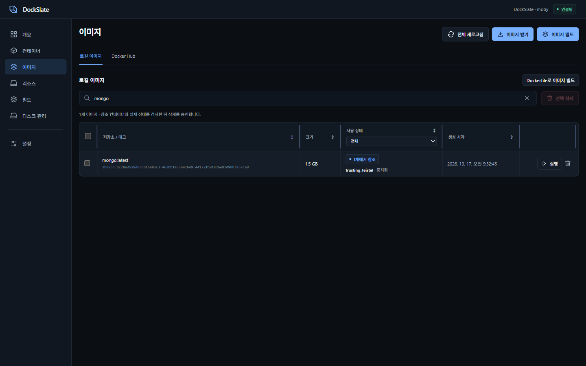

# DockSlate

Windows 11용 Docker 관리 앱입니다. 전용 Docker Engine과 Windows CLI를 준비하고 컨테이너·이미지·Dockerfile·Compose를 관리합니다.

**[웹사이트](https://seo-gali.github.io/dockslate/)** · [빠른 시작](USER_GUIDE.md) · [지원·검증 현황](docs/REQUEST_STATUS.md)

**[설치 EXE](https://seo-gali.github.io/dockslate/downloads/DockSlate_0.1.6_x64-setup.exe)** · **[포터블 ZIP](https://seo-gali.github.io/dockslate/downloads/DockSlate-0.1.6-windows-x64.zip)**

0.1.6에서 미사용 코드와 중복 사이트 생성물을 제거하고 README·문서를 정리했습니다. [검증·설치 파일 내부 검사](docs/results/release-0.1.6.md). WSL 커널 수정은 별도 호스트 작업이며 설치 파일에 포함하지 않습니다.

> **미서명 개발 버전.** 과거 IObit 접근 알림의 조사 범위와 남은 확인 사항은 [보안 검사 기록](docs/results/code-signing.md)에서 확인할 수 있습니다.

## 프로그램 화면



0.1.3 Windows 앱 검증 중 캡처한 화면입니다. [검증 기록](docs/results/release-0.1.3.md)

## 기능

| 작업 | 지원 기능 |
| --- | --- |
| 컨테이너 | 시작·중지, 이름·포트·네트워크·볼륨 수정, 로그·터미널·파일 |
| 이미지·빌드 | Docker Hub, Dockerfile·Compose 가져오기 |
| 리소스 | 볼륨·네트워크·이미지의 참조 컨테이너, 선택 정리, WSL 디스크 상태 |

## 시작하기

필수 환경: **Windows 11 x64 · WSL 2.4.10+ · WebView2**. 최초 엔진 설치에는 인터넷이 필요합니다.

1. 설치 EXE를 실행하고 엔진 준비 대상과 영향을 확인해 승인합니다. 포터블은 ZIP 전체를 풀고 `DockSlate.exe`를 실행합니다.
2. **이미지 → Docker Hub**에서 검색·선택해 받은 뒤, **로컬 이미지 → 실행**에서 컨테이너를 생성합니다.
3. 컨테이너 목록에서 상태와 포트를 확인합니다. 이름을 누르면 로그·터미널·파일이 열립니다.

직접 빌드·실행할 파일은 [examples/basic-web](examples/basic-web/README.md)에 있습니다. Dockerfile과 Compose 파일을 앱에서 선택해 사용할 수 있으며 컨테이너를 자동 실행하지 않습니다.

설치 후 새 CMD·PowerShell에서 사용할 수 있습니다.

```powershell
docker ps
docker compose version
docker buildx version
```

포터블은 `bin`·`libexec`를 함께 유지하고 `bin\docker.exe`를 사용합니다. 앱 제거로 전용 WSL 배포판·이미지·볼륨을 자동 삭제하지 않습니다.

컨테이너의 **작업 → 수정…**에서 변경 내용을 확인하고 적용합니다. 포트·볼륨·네트워크 변경은 재생성이 필요하며 기존 파일은 로컬 이미지에 보존합니다. 볼륨은 삭제하지 않습니다. [수정 범위와 주의사항](USER_GUIDE.md)

## 구성


Docker Desktop을 따로 설치할 필요는 없습니다. Linux 컨테이너는 DockSlate 전용 WSL 2에서 실행합니다. Compose 가져오기는 제한된 구성을 지원하며 Kubernetes 배포는 지원하지 않습니다.

소스 작업 폴더의 `.analysis`는 조사·검증용 임시 자료이며 앱 실행이나 엔진 설치에 필요하지 않습니다. 다운로드 사본·압축 해제본·테스트 브라우저 캐시가 포함될 수 있습니다. 실제 WSL·Docker 데이터와 분리되어 있으며, 실행 중인 검증과 조사 원본을 확인한 뒤 정리합니다.

Moby 기반 Docker Engine은 [Apache-2.0](https://github.com/moby/moby/blob/master/LICENSE) 오픈소스로 엔진 사용료가 없습니다. Docker Desktop 구독은 필요하지 않습니다. Docker Hub·컨테이너 이미지·외부 서비스에는 각각의 이용 조건이 적용됩니다.

라이선스·저작권 고지와 버전별 소스는 설치 폴더·ZIP의 `licenses`에 포함합니다. [타사 고지](THIRD_PARTY_NOTICES.md) · [구성 요소·소스 목록](licenses/README.md) · [검증 기록](docs/results/license-delivery.json). Ubuntu·Linux 엔진은 공식 서버에서 별도로 내려받으며 각 패키지의 조건을 따릅니다.

## 개발

Node.js/npm·Rust MSVC·Microsoft C++ Build Tools·Windows SDK가 필요합니다. `npm ci` 후 `.\scripts\desktop.ps1 -Mode dev`로 시작합니다.

[개발·빌드와 저장소 구성](docs/DEVELOPMENT.md) · [Pages 안내](docs/PAGES.md)

[웹사이트 화면](docs/assets/site-desktop.png) · [모바일 화면](docs/assets/site-mobile.png) · [로컬 안내서](guide.html)

[작업 지침](AGENTS.md) · [코딩 표준](docs/CODING_STANDARDS.md) · [UI 기준](docs/DESIGN.md) · [배포 전 점검](docs/results/production-readiness.md) · [외부 구성 요소 고지](THIRD_PARTY_NOTICES.md)
