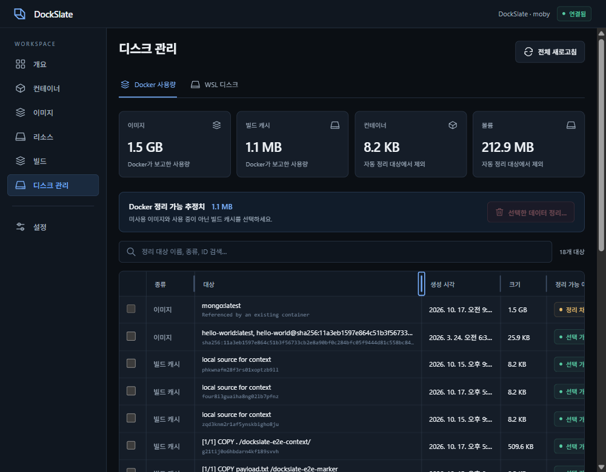
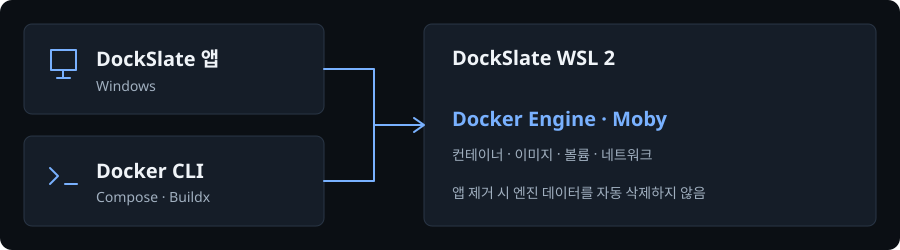

# DockSlate

Windows 11용 Docker 관리 앱입니다. 전용 Docker Engine과 Windows CLI를 준비하고 컨테이너·이미지·Dockerfile·Compose를 관리합니다.

**[웹사이트](https://seo-gali.github.io/dockslate/)** · [빠른 시작](USER_GUIDE.md) · [지원·검증 현황](docs/REQUEST_STATUS.md)

> **미서명 개발 버전.** 이전 브라우징 데이터 접근 경고의 원인은 미확인입니다. [서명·보안 상태](docs/results/code-signing.md)

## 프로그램 화면



실제 Windows 앱 검증 중 캡처한 화면입니다. [검증 기록](docs/results/table-layout.md)

## 기능

| 작업 | 지원 기능 |
| --- | --- |
| 컨테이너 | 시작·중지, 포트, 로그·터미널·파일 |
| 이미지·빌드 | Docker Hub, Dockerfile·Compose 가져오기 |
| 리소스 | 볼륨·네트워크, 선택 정리, WSL 디스크 상태 |

## 시작하기

필수 환경: **Windows 11 x64 · WSL 2.4.10+ · WebView2**. 최초 엔진 설치에는 인터넷이 필요합니다.

1. 설치 EXE를 실행하고 엔진 준비 대상과 영향을 확인해 승인합니다. 포터블은 ZIP 전체를 풀고 `DockSlate.exe`를 실행합니다.
2. **이미지 → 이미지 받기 → 실행**에서 컨테이너를 생성합니다.
3. 컨테이너 목록에서 상태와 포트를 확인합니다. 이름을 누르면 로그·터미널·파일이 열립니다.

설치 후 새 CMD·PowerShell에서 사용할 수 있습니다.

```powershell
docker ps
docker compose version
docker buildx version
```

포터블은 `bin`·`libexec`를 함께 유지하고 `bin\docker.exe`를 사용합니다. 앱 제거로 전용 WSL 배포판·이미지·볼륨을 자동 삭제하지 않습니다.

## 구성



Docker Desktop을 따로 설치할 필요는 없습니다. Linux 컨테이너는 DockSlate 전용 WSL 2에서 실행합니다. Compose 가져오기는 제한된 구성을 지원하며 Kubernetes 배포는 지원하지 않습니다.

## 개발

Node.js/npm, Rust MSVC, Microsoft C++ Build Tools·Windows SDK가 필요합니다.

```powershell
npm ci
.\scripts\desktop.ps1 -Mode dev
```

| 작업 | 명령 |
| --- | --- |
| 앱 빌드 | `.\scripts\desktop.ps1 -Mode build` |
| CLI 빌드 | `.\scripts\build-cli.ps1` |
| ZIP 생성 | `npm run package:local` |
| 사이트 미리보기 | `npm run build:site` → `site-dist/index.html` |

사이트 원본은 `site/index.html`, 앱 진입점은 루트 `index.html`입니다. 실행 파일 준비·고정 해시·게시 조건은 [빌드·Pages 안내](docs/PAGES.md)를 확인하세요.

현재 공개 주소에는 이전 `main`의 앱 안내가 게시되어 있습니다. 새 사이트·Google 소유권 파일의 공개 반영과 Release 다운로드 등록은 남아 있습니다.

[웹사이트 화면](docs/assets/site-desktop.png) · [모바일 화면](docs/assets/site-mobile.png) · [로컬 안내서](guide.html)

[작업 지침](AGENTS.md) · [코딩 표준](CODING_STANDARDS.md) · [UI 기준](DESIGN.md) · [외부 구성 요소 고지](THIRD_PARTY_NOTICES.md)
