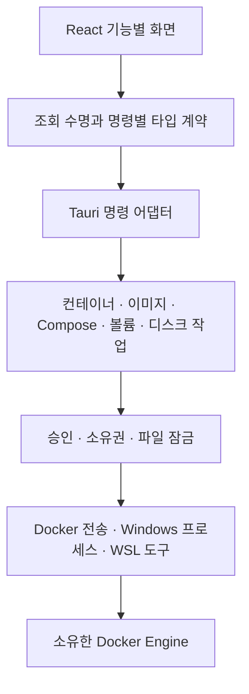

# 프로젝트 구조·의존성·테스트 검토

현재 구조는 아래 표를 기준으로 읽는다. 이후 절은 2026-11-15 최초 감사와 11월 16일 후속 작업의 고정 기록이며 당시 버전·개수·문제를 현재 상태로 해석하지 않는다.

| 경로 | 현재 책임 |
| --- | --- |
| `src/api.ts` · `src/ipc/` | 호환 export, 명령별 인수·응답 계약과 호출 경계 |
| `src/queries.ts` | 고정 조회 슬롯·현재 화면 데이터·진행 중 요청 병합·Docker 이벤트 반영 |
| `src/App.tsx` · `src/pages/` · 기능 컴포넌트 | 7개 메뉴·진행 작업·기능별 UI |
| `src-tauri/src/runtime.rs` · `transport.rs` | 소유 엔진 수명·lease와 기존 연결의 전송 |
| `migration.rs` · `migration/binds.rs` | Desktop 이전 검사·승인·복사·실행 상태와 bind 계획·tar 검사 |
| `pipe.rs` · `cli_platform.rs` · `bin/docker.rs` | 사용자별 엔진 pipe·Windows launcher·공식 CLI 실행 |
| `scripts/check.mjs` · `check-windows.ps1` | 엔진 비접촉 검사·Rust 보안·PATH·Windows 프로세스 검사 |
| `site/release.json` · 버전별 공개 기록 | 앱 개발 버전과 독립된 공개 0.1.13 자산·해시·검사·사이트 생성 |

현재 소스의 Desktop 조회 후속 수정은 아직 공개 파일에 포함되지 않았다. 최신 실행 근거와 남은 범위는 [요청 현황](REQUEST_STATUS.md)을 따른다.

## 2026-11-15 최초 감사와 후속 적용

검토: 2026-11-15. 기준: `8089ea7`와 로컬 설치 hook 수정. 재현·컴파일 검사는 2026-11-11 실행 결과이며, 재개 시 관련 소스와 작업 상태가 같은 것을 확인했다.

DockSlate는 Windows 사용자 한 명이 전용 WSL Docker 엔진을 GUI와 여러 CLI 프로세스로 관리하는 앱이다. 단일 GUI, 여러 CLI 연결, 수십~수백 개 목록과 제한된 동시 작업을 기준으로 보았다. 여러 고객이 접속하는 서버 규모를 가정하지 않았다.

요청한 다섯 범위의 최초 검토와 후속 수정을 구분한다. 아래 문제·수치는 11월 15일 감사 시점의 관측이다. 당시 사용자 승인 후 적용한 변경은 다음과 같다. 앞선 설치 오류 수정은 별도 [기록](results/installer-upgrade.md)으로 구분한다.

| 항목 | 후속 적용 |
| --- | --- |
| 1. 프로세스 반환 제한 | Windows 소유 I/O 핸들의 취소. 엔진·지속 자식의 일괄 종료 없이 파이프 대기 해제 |
| 2. CI | 기존 workflow에 엔진 비접촉 검사와 Windows 잠긴 Rust·프로세스 검사 정의 |
| 3. 옛 탐색 검사 | 개인 경로·폐기 UI·DOM 객체 동일성 검사 삭제. 현재 7개 화면·상태 유지·중복 IPC 검사 유지 |
| 4. 검사 진입점 | Node 내장 검사 허용, 공통 check / check:windows 추가 |
| 5. IPC | 명령 85개의 인수·결과 계약과 DTO 이동. 현재 조회 슬롯·mask는 단일 정의 |
| 6. Rust 책임 | Transport 이동·소유권 lease 유지, 네트워크 생성은 resources로 이동, 집계 응답 구조체화 |
| 7. 사이트 | 개발 0.1.10과 독립적으로 공개 0.1.9·고지·체크섬 검증 후 빌드 |
| 8. 동봉 문서 | EXE·ZIP 공통 목록. 과거 결과·조사 전체 복사 제거, 법적 원본 유지 |
| 9. CDP | 네이티브/격리 브라우저 경계를 유지하며 현재 검사 2개의 연결·요청 정리를 공통화 |

실행 결과와 미검증 경계는 [수정 검증 기록](results/architecture-refactor.md)을 기준으로 확인한다. 원격 CI 실행·새 설치판 제작·배포는 이 작업에 포함하지 않는다.

## 최초 검토 시 구조와 책임

| 경로 | 감사 당시 역할 | 판단 |
| --- | --- | --- |
| `src/main.tsx`, `src/App.tsx` | UI 부트스트랩·화면 전환·진행 작업·트레이 이벤트 | 앱 조립과 기능별 작업 상태가 함께 있음 |
| `src/api.ts` | IPC 호출·응답 타입·현재 조회 상태·요청 병합·이벤트 재조회 | 결과 캐시를 더하기보다 계약과 조회 수명을 분리할 지점 |
| `src/pages`, 기능별 컴포넌트 | 목록·상세·설정·승인 화면 | 기존 기능별 구분을 유지할 가치가 있음 |
| `src-tauri/src/main.rs` | IPC 등록·작업 차단·종료·설치 준비 | 상당 부분은 얇은 명령 래퍼이며 줄 수만으로 재작성할 대상은 아님 |
| `docker.rs` | 연결 확인·조회 집계·컨테이너 생성·이미지·네트워크·정리 | 서로 다른 기능의 정책이 한 모듈에 모임 |
| `runtime.rs` | WSL 런타임 제어·소유권·파일 잠금·Docker HTTP 전송 | 엔진 수명과 전송 구현의 경계가 섞임 |
| `compose.rs`, `container_edit.rs`, `volumes.rs`, `wsl.rs` | 미리보기·승인·재검사·실행·결과/복구 | 데이터 보존 경계를 유지하면서 분리해야 함 |
| `pipe.rs`, `cli_platform.rs`, `process.rs` | Windows 통신·프로세스·CLI 연결 | 이미 있는 기반 코드를 재사용하고 시간 제한 문제부터 해결 |
| `scripts`, `.github` | 빌드·수동 검증·게시 | 안전 검증과 옛 검사가 섞였고 자동 CI 범위는 좁음 |
| `site`, `docs`, `licenses` | 공개 사이트·개발/실행 기록·법적 고지 | 세 자료의 수명과 패키징 대상을 분리할 필요 |

조사 시 UI 46개 파일 약 5,256줄, Rust 소스 24개 약 15,298줄, 검증 스크립트 49개, Markdown 문서 62개였다. 줄 수는 조사 시작 시점의 규모이며 생성물·의존성 소스는 제외했다.

따라간 주요 흐름은 UI → IPC → Docker/런타임 조회, 외부 Docker 이벤트 → 부분 재조회, 파일 선택 → Compose 검사·빌드·별도 실행 승인, 컨테이너 수정 → 보존 이미지·재생성·복구, 볼륨/WSL 작업 → 승인·소유권 재검사, Windows CLI → 소유 pipe, 설치 → 기존 제거 프로그램 호출이다.

## 최초 감사에서 확인한 문제

### 1. 프로세스 시간 제한이 실제 반환 시간을 제한하지 못한다

- **위치:** [process.rs](../src-tauri/src/process.rs#L104), 호출자는 `runtime.rs`, `compose.rs`, `container_tools.rs` 등.
- **하는 일:** 외부 프로그램의 출력 크기와 대기 시간을 제한한다.
- **문제:** 시간 초과 때 직접 시작한 프로세스만 죽인 뒤 입출력 스레드를 무제한 `join`한다. 자식이 출력 파이프를 물려받아 계속 살아 있으면 반환이 늦어진다. 실제 생산 `process.rs`를 포함한 격리 실행에서 **1,000ms 제한이 3,809ms**에 반환됐고, 자식이 시작됐다는 별도 기록도 확인했다. 최초 200ms 시험은 자식 시작 전 종료되어 이 근거에서 제외했다.
- **최소 수정:** 일시적으로 시작한 Windows 명령과 그 하위 프로세스의 수명을 묶고, 파이프 읽기·쓰기 취소도 제한 시간 안에 끝내야 한다. `pipe.rs`의 `CancelSynchronousIo` 처리 방식과 소유 핸들 관리부터 재사용할 수 있다. 엔진 keepalive·pipe broker처럼 계속 살아야 하는 프로세스는 구분한다. 모든 자식을 반환 시 죽이는 변경은 정상 엔진까지 종료할 수 있다. WSL 내부 작업 취소는 별도로 다루며 전체 WSL 종료로 대체하지 않는다.
- **그대로 두면:** 상위 함수의 제한 시간과 UI 안내를 믿을 수 없다. 긴 작업의 잠금·종료 대기가 계속 남을 수 있다. 후속 수정은 위 표와 수정 검증 기록을 따른다.

## 최초 감사에서 제안한 개선

### 2. CI 성공이 TypeScript·Rust 검사 성공을 뜻하지 않는다

- **위치:** [workflow-pins.yml](../.github/workflows/workflow-pins.yml#L20), [pages.yml](../.github/workflows/pages.yml#L29).
- **하는 일:** 외부 Actions의 SHA 고정을 검사하고 준비된 사이트를 게시한다.
- **문제:** 일반 push/PR의 상시 검사는 workflow pin 검사다. 앱 소스에 TypeScript/Rust 컴파일 오류가 생겨도 이 검사만으로는 잡지 못한다. Pages 작업도 개발·공개 버전이 다르면 앱 검사를 대신하지 않는다.
- **최소 수정:** 기존 CI에 빠른 TypeScript 검사와 잠긴 Rust 검사 단계를 추가한다. 엔진을 바꾸는 E2E·설치 EXE 제작·공개 배포는 별도 작업으로 유지한다.
- **그대로 두면:** 초록색 CI를 보고 컴파일·사용자 경로까지 통과했다고 오인하기 쉽다. 후속 변경은 정의 수정이며 원격 실행과 구분한다.

### 3. 옛 탐색 검사가 현재 앱과 다른 제품을 요구한다

- **위치:** `scripts/verify-navigation-cache.mjs` (후속 수정에서 삭제).
- **하는 일:** 화면 전환 시 데이터와 입력이 유지되고 불필요한 조회가 없는지 확인한다.
- **문제:** 설치 위치를 과거 개인 경로로 고정하고, 화면을 5개로 요구하며, 제거된 backup 입력을 찾는다. 현재 `App.tsx`는 7개 화면이고 새 런타임 기본 위치도 다르다. 또한 `verifyReference`는 DOM 노드가 같은 객체여야 한다고 요구해, 같은 입력·데이터를 복원하는 정상적인 재마운트 설계까지 거부한다.
- **최소 수정:** 현재 [verify-frontend-refinements.mjs](../scripts/verify-frontend-refinements.mjs)·[verify-global-refresh.mjs](../scripts/verify-global-refresh.mjs)와 중복 범위를 비교해 필요한 동작만 옮기고 옛 검사는 실행 대상에서 은퇴시킨다. 데이터·입력 유지와 요청 수는 지키되 특정 DOM 객체·옛 경로를 제품 계약으로 쓰지 않는다.
- **그대로 두면:** 정상 확장이 테스트 수정 작업으로 번지고 현재 앱은 옛 검사에서 시작조차 못 한다. 바이너리 해시·fixture 소유권·원본 데이터 보존 검사는 이 문제와 달리 필요한 안전 조건이므로 유지한다.

### 4. 단위 검사 전면 금지와 단일 검증 진입점 부재가 작은 변경을 무겁게 한다

- **위치:** [CODING_STANDARDS.md](CODING_STANDARDS.md#검증), [package.json](../package.json#L6), `scripts/verify-*`.
- **하는 일:** 실제 사용자 경로를 우선 검사한다.
- **문제:** 49개 검증 스크립트에 공통 실행 목록이 없고, 규칙은 단위 검사를 일괄 금지한다. 경로·아카이브·승인 만료 같은 순수 로직의 작은 변경도 Windows GUI·엔진 fixture 준비로 번진다. 일부 검사는 폐기된 `.analysis` 세션 파일을 전제로 한다.
- **최소 수정:** 실제 OS 경계·승인·복구는 E2E로 유지하고, 순수 파서·정규화·제한값은 기존 언어의 작은 검사로 허용하는 규칙 변경을 제안한다. 검증 목록은 엔진 비접촉 / Windows 전용 / 승인된 fixture 변경으로 나눠 한 진입점에서 선택한다.
- **그대로 두면:** 전체 검사를 피하거나 과거 결과를 재사용하기 쉬워진다. 후속 수정은 Node 내장 검사를 사용하며 새 테스트 프레임워크를 도입하지 않는다.

### 5. IPC 계약과 조회 슬롯의 의미가 여러 곳에 흩어져 있다

- **위치:** [api.ts](../src/api.ts#L148), [main.rs](../src-tauri/src/main.rs#L267), Rust의 `serde_json::Value` 응답.
- **하는 일:** 화면과 Rust 사이에 명령·인수·응답을 전달한다. IPC는 이 두 프로세스 사이의 호출 경계다.
- **문제:** `backend<T>(command: string, args?: Record<string, unknown>)`는 명령 오타와 잘못 고른 응답 타입을 컴파일 단계에서 거부하지 않는다. 조회 명령 순서·숫자 슬롯·이벤트 mask도 별도로 관리해 새 항목 추가 시 여러 목록을 함께 맞춰야 한다. 현재 잘못 등록된 명령을 발견했다는 뜻은 아니다.
- **최소 수정:** 기존 TypeScript에 명령별 인수/결과 맵을 두고, 중요한 Rust 응답부터 `Serialize` 구조체로 정의한다. 조회의 의미는 한 정의에서 연결하되 실행 시 배열·비트셋 구조와 현재 요청 병합은 유지한다.
- **그대로 두면:** 필드 이름·명령·슬롯을 바꾸는 확장이 실행 후 오류로 드러나기 쉽다. 새 타입 생성 패키지나 결과 캐시를 추가할 필요는 없다.

### 6. 엔진 수명·전송과 기능 정책이 한 파일에 섞여 있다

- **위치:** [runtime.rs의 Transport](../src-tauri/src/runtime.rs#L895), [docker.rs 집계](../src-tauri/src/docker.rs#L362), [네트워크 생성](../src-tauri/src/docker.rs#L759), [컨테이너 생성](../src-tauri/src/docker.rs#L861).
- **하는 일:** `runtime.rs`는 엔진 설치/시작과 소유권뿐 아니라 Docker HTTP 요청도 구현한다. `docker.rs`는 조회 집계와 여러 기능의 변경 정책을 함께 구현한다.
- **문제:** HTTP 파서·시간 제한 변경과 엔진 설치 변경이 같은 모듈에 걸리고, 네트워크 기능도 조회는 `resources.rs`, 생성은 `docker.rs`로 나뉜다. 경계 하나를 바꾸려 해도 관련 없는 작업·검증을 함께 읽어야 한다.
- **최소 수정:** 우선 소유권을 검사한 연결/lease를 받는 transport를 분리하고, 네트워크 작업을 기존 `resources.rs` 경계로 모은다. `docker_snapshot`은 조회 조합으로 남긴다. 파일이 길다는 이유만으로 모두 쪼개지 않는다.
- **그대로 두면:** 새 기능마다 공유 모듈을 넓게 수정하고 검토 범위가 계속 커진다. 명령·lease·파일 잠금·승인 검사는 이동 과정에서 줄이지 않는다.

### 7. 웹사이트 수정이 미출시 앱 버전에 묶인다

- **위치:** [build-site.mjs](../scripts/build-site.mjs#L10), [pages.yml](../.github/workflows/pages.yml#L41).
- **하는 일:** 검증된 공개 배포물로 사이트를 만든다.
- **문제:** 앱 개발판 0.1.10과 공개판 0.1.9가 다르면 사이트 빌드가 중단되고 Pages build/deploy도 건너뛴다. 실제 명령도 종료 1을 재현했다. 개발판 검토가 길어지면 공개 0.1.9 사이트의 설명 수정까지 함께 막힌다. 현재 동작은 기존 배포 보호 장치이며 이를 몰래 해제하지 않았다.
- **최소 수정:** 공개 Release 메타데이터·원본 자산·해시·게시 승인을 기준으로 사이트를 만들고 앱의 개발 버전과 분리한다. 보안 보류 상태나 자산 검증을 생략하는 미리보기·게시 우회는 만들지 않는다.
- **그대로 두면:** 사이트와 앱의 릴리스 주기가 불필요하게 같아진다. 현재 중단 조건은 개발 문서에 명시했다.

### 8. 포터블 패키지는 연구·작업 기록까지 전부 복사한다

- **위치:** [package-local.ps1](../scripts/package-local.ps1#L60), [tauri.installer.conf.json](../src-tauri/tauri.installer.conf.json#L12).
- **하는 일:** 앱 도움말과 배포 고지를 동봉한다.
- **문제:** 포터블은 `docs/results`·`docs/research` 전체를 복사하고 설치판은 선별한 문서 목록을 사용한다. 실제 0.1.10 ZIP 622개 항목 중 과거 조사/결과가 **223개, 압축 전 1,797,219바이트**였다. A/B 실험·미전송 IObit 초안·초기 MVP 기록도 들어 있다. 이 자료가 새로 유출됐거나 악성이라는 주장은 아니다.
- **최소 수정:** 사용자 안내·현재 배포 증거·법적 고지의 공통 동봉 목록을 만들고 두 패키징 경로가 사용하게 한다. 과거 기록과 원본은 저장소에 남긴다. 라이선스·요구되는 소스 제공 범위는 줄이지 않는다.
- **그대로 두면:** 문서를 추가할 때마다 제품 묶음이 바뀌고 EXE·ZIP의 설명 범위가 달라진다. 현재 배포물은 수정하거나 다시 만들지 않았다.

## 작은 정리 제안

### 9. 검증용 CDP 연결 구현을 기존 공통 도구로 모을 수 있다

- **위치:** [native-verification.mjs](../scripts/native-verification.mjs), 검증 스크립트의 `new WebSocket` 처리.
- **하는 일:** CDP라는 브라우저 검사 통신으로 실제 WebView를 조작한다.
- **문제:** 23개 검사는 공통 `connectNative`를 쓰지만 19개는 자체 연결·요청 추적 코드를 가진다. 연결 종료·시간 초과 처리 개선이 여러 파일에 반복된다.
- **최소 수정:** 현재 검사로 옮기는 파일부터 기존 helper를 재사용한다. 독립 Chrome 전용 검사의 세션/loopback 검증을 삭제하고 모두 같은 것으로 취급하지 않는다.
- **그대로 두면:** 유지할 코드가 늘어난다. 서로 다른 검사 환경을 한 추상화로 무리하게 합칠 이유도 없다.

## 불필요한 의존성

**직접 의존성에서 삭제가 입증된 항목은 0개다.** import가 없는 수동 빌드 도구와 자동 포함되는 타입 패키지도 실제 사용 경로를 확인했다.

| 구분 | 의존성 | 확인한 사용처 |
| --- | --- | --- |
| npm 실행 3개 | `react`, `react-dom`, `@tauri-apps/api` | `main.tsx`, UI 컴포넌트, `api.ts`, 트레이 이벤트 |
| npm 개발 5개 | `@tauri-apps/cli`, `typescript`, `vite`, `@types/react`, `@types/react-dom` | npm/Tauri 명령, `tsc`, `vite.config.ts`, TSX와 `createRoot` 타입 검사 |
| Rust 실행 3개 | `tauri`, `serde`, `serde_json` | 앱/트레이/IPC, 구조체 변환, Docker·WSL JSON |
| Rust 빌드 1개 | `tauri-build` | `build.rs` |

Rust 잠금 파일의 많은 항목은 Tauri·운영체제 기능의 전이 의존성이다. 항목 수나 직접 import 여부만 보고 삭제하지 않는다. 온라인 취약점 조회와 전이 의존성 전체의 불필요 기능 감사는 이번 검사에 포함하지 않았다. 패키지·버전·lock은 변경하지 않았다.

## 문서 맵과 적용한 정리

| 역할 | 기준 문서 |
| --- | --- |
| 제품 소개·다운로드 | 루트 `README.md` |
| 지원 범위·사용 순서 | `USER_GUIDE.md` |
| 문서의 진입점 | `docs/README.md` |
| 빌드·개발 환경 | `DEVELOPMENT.md` |
| 웹사이트 게시 | `PAGES.md` |
| 코드·UI 계약 | `CODING_STANDARDS.md`, `DESIGN.md` |
| 현재 구현/검증/배포 요약 | `REQUEST_STATUS.md`, `results/production-readiness.md` |
| 날짜·버전이 고정된 관측 | `results/`, `research/`, `releases/` |
| 법적 원본·호환 URL | `licenses/`, `docs/downloads/` |

적용한 변경은 다음과 같다.

- `.project/plan.md` 제거. 0.1.6을 현재 기준으로 적던 중복 문서다. 고유한 미지원 범위는 사용 안내에 통합했고 현재 링크를 수정했다. 과거 A/B·문서 검사 JSON의 파일명은 당시 기록이므로 그대로 보존했다.
- 문서 안내의 개발/공개 버전 혼동 수정: 개발 0.1.10·공개 0.1.9·설치판 배포 보류를 구분했다.
- 트레이는 구현된 개발판 기능이며 공개 0.1.9에는 없음을 사용 안내·UI 기준에서 명시했다.
- 개발판 고지 0.1.10과 공개판 고지를 구분했다. 당시 막히던 사이트 빌드는 후속 수정으로 공개판 기준 독립 빌드가 가능해졌다.
- 과거 릴리스·보안 추적·설치 관측·법적 원본은 삭제하거나 재검증한 것처럼 고쳐 쓰지 않았다. 이번 구조 제안은 새 문서 한 개에 모았다.

## 이후 확장을 위한 설계 제안

프로세스 제한·공통 검사·IPC 계약·transport 분리·공개판 독립 사이트·공통 문서 목록은 이미 적용했다. 아래 단계 중 작업 충돌 상태 모델과 추가 기능 분리만 실제 확장 요구가 생길 때 검토한다.

목표는 **기능 경계가 있는 단일 앱**이다. 서비스·플러그인 시스템·DI 프레임워크를 새로 만들기보다 이미 있는 모듈과 도구를 정리한다. 데이터 지향 배열·비트셋과 진행 중 요청 병합도 유지하며 결과 캐시를 추가하지 않는다.



첫 단계는 1번의 프로세스 종료·I/O 제한과 빠른 검사 진입점이다. 종료 기준은 소유 자식 프로세스가 파이프를 잡은 경우에도 제한 시간 안에 취소 결과가 돌아오고 원본 엔진·데이터를 건드리지 않는 것이다.

두 번째는 계약이다. 위험한 변경 명령과 자주 조회하는 응답부터 명령별 인수/결과 타입과 오류 코드를 정한다. Rust의 `serde`와 TypeScript를 사용하며 새 패키지는 전제하지 않는다. 종료 기준은 명령·인수·응답 필드의 변경을 해당 경계 검사에서 잡는 것이다.

세 번째는 책임 이동이다. `runtime`은 설치·시작·중지·소유권, `transport`는 이미 검증한 연결의 요청/응답, 기능 모듈은 미리보기·실행·결과를 담당하게 한다. `container_tools`의 파일 탐색과 터미널 수명도 실제 변경이 필요할 때 나눈다. 명령 이름과 JSON 호환성을 먼저 유지하고 한 기능씩 이동한다.

네 번째는 진행 작업이다. 현재 여러 `is_busy`와 UI boolean을 바로 없애지 말고, 작업 종류·엔진 ID·충돌 조건·취소 가능 여부를 한 운영 규칙으로 모은다. 이를 종료·런타임·디스크 작업이 함께 읽도록 바꾼다. 승인 토큰·TTL·실행 직전 재검사·롤백은 기능별로 남겨 데이터 보존 경계를 유지한다.

마지막은 배포와 문서다. 앱 제작 영수증, 공개 Release 영수증, 웹사이트 메타데이터의 책임을 분리하고 공통 동봉 목록을 사용한다. 배포 승인·SHA·검사 결과·과거 고지 URL을 유지하면서 공개판 사이트를 독립 수정할 수 있어야 한다.

한 번에 디렉터리를 바꾸는 작업은 제안하지 않는다. 각 단계에서 기존 사용자 동작과 승인/복구 계약을 유지한 뒤 다음 단계로 이동한다. 여러 엔진·원격 관리·새 서버가 실제 요구가 되기 전에는 그 전용 계층을 만들지 않는다.

역할을 옮길 때의 후보 배치는 다음과 같다. 처음에는 Rust crate 하나와 React 앱 하나를 유지하고, 해당 기능을 바꾸는 단계에서 필요한 파일만 만든다.

```text
src/
  ipc/          명령별 인수·결과·오류 계약
  queries/      현재 조회 상태·진행 중 요청·Docker 이벤트 반영
  features/     컨테이너·이미지·빌드 등 기능별 화면과 작업 상태
src-tauri/src/
  commands/     Tauri 인수 수신·응답 변환
  engine/       런타임 수명·소유권 lease·Docker 전송
  containers/   조회·생성·수정·상세 작업
  platform/     기존 Windows 프로세스·pipe·파일 선택 도구
```

새 기능의 흐름은 `화면 → 타입 계약 → 명령 → 기능 정책 → 소유권 검사 → 전송`으로 고정한다. `commands`에서 임의 OS 명령을 만들어 실행하거나 화면에서 엔진 소유권을 대신 판단하지 않는다. 설치 경로 복원도 NSIS/Windows 경계의 기능이며 Docker 작업에 합치지 않는다.

## 최초 감사의 검증과 한계

- `node node_modules/typescript/bin/tsc --noEmit`: 종료 0.
- `cargo check --locked --offline --manifest-path src-tauri/Cargo.toml`: 로컬 `.tools` 환경에서 종료 0, 약 12.3초. 의존성 다운로드·lock 갱신 없음.
- 실제 `process.rs`를 포함한 격리 Windows 프로세스 재현: 제한 1,000ms, 반환 3,809ms, 자식 시작 확인. 앱·WSL·컨테이너 호출 없음.
- 완료한 NSIS 시험 폴더 8개와 Rust 재현 EXE 1개는 경로·소스 식별·실행 여부를 확인해 정리했다. 재현 소스·검사 영수증·설치 등록 복구 기록은 보존했다.
- `node scripts/build-site.mjs`: 버전 불일치로 예상한 종료 1. 사이트 출력 생성·게시 없음.
- 문서 링크 검사와 workflow pin 검사는 정리 후 실행했다. 최종 수치와 명령 종료 상태는 [검토 영수증](results/architecture-review.json)에 기록한다.
- Rust·TS의 각 함수와 CSS 전체를 줄 단위로 감사한 것은 아니다. Win32 FFI 전체·아카이브 전체 입력 공간·보안 제품 탐지 원인·새 패키징·실제 설치/제거·사용자 엔진을 바꾸는 E2E는 실행하지 않았다. 사용하던 앱·컨테이너·이미지·볼륨은 변경하지 않았다.

판단: 재작성보다 **시간 제한 수정 → 검증 정리 → 계약 명확화 → 기능별 책임 이동** 순서가 적합하다. 이번에 제거한 제품 범위 문서는 35줄이며 삭제 가능한 직접 의존성은 0개다. 검증 helper 통합의 줄 수 절감은 실제 이동 전에는 추정하지 않았다.
